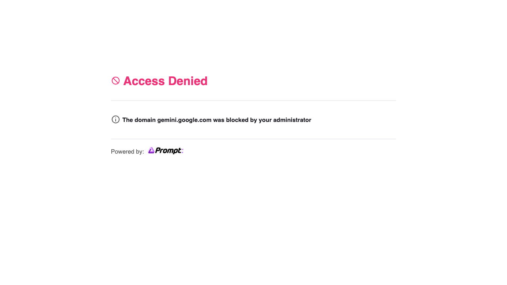
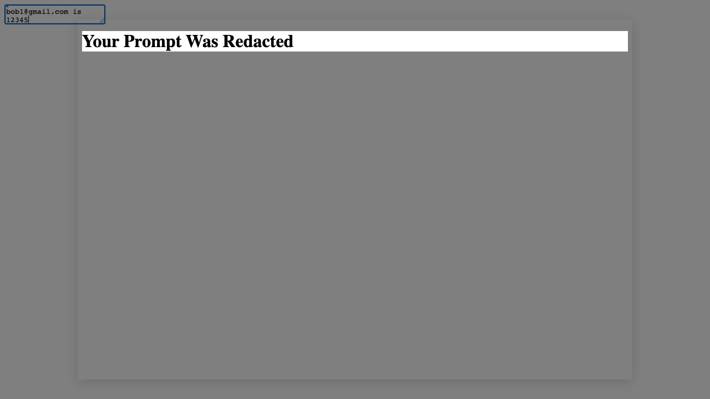

# GenAI access policy tests

Playwright tests that check whether the Prompt Security browser extension enforces its GenAI policy: ChatGPT is allowed and protected, Gemini is blocked. The [test plan](docs/test-plan.md) lists the scenarios.

| Suite | Extension | Backend and sites |
| --- | --- | --- |
| [E2E](tests/e2e) | Real, pinned Chrome Web Store build | Assigned EU tenant by default ([configurable](#environments)), real signed-out ChatGPT and Gemini |
| [Client only](tests/client) | Same build | Mock API, real signed-out ChatGPT and Gemini ([or mock pages](#mock-pages)), no API key needed |
| [Server only](tests/server/README.md) | None | Planned |

Both suites run on every pull request and [on demand](#ci). Here is [a successful run](https://github.com/naftalibp/automation-tests/actions/runs/45373711719).

## Tests

| Suite | Test |
| --- | --- |
| E2E | ChatGPT is allowed: the page loads and its message box is editable |
| E2E | Gemini is replaced by the Prompt Security "Access Denied" page |
| E2E | An innocent ChatGPT message gets a response and no popup |
| E2E | A ChatGPT message with sensitive data shows the "Redacted" popup |
| Client | With a `Block` rule, Gemini is replaced by the block page |
| Client | With a `Protect` rule, Gemini is not blocked |
| Client | With a `Protect` rule, sensitive data is removed from the message before it reaches ChatGPT, and the popup is shown |
| Client | Without a rule, the same message is sent unchanged |

## Run locally

Requires Node.js 20.19 or newer.

```sh
npm ci
npx playwright install chromium
npm run extension:fetch
npm run check
npm run test:client
```

Both suites open browser windows, because ChatGPT challenges headless browsers. On a Linux system without a display, put `xvfb-run -a` before the test commands. The client tests with [mock pages](#mock-pages) need no display.

On a minimal Linux system use `npx playwright install --with-deps chromium`. To use an existing copy of the pinned CRX, set `EXTENSION_CRX` to its path and skip the fetch.

The E2E tests also need the assignment API key. Save it once: copy [.env.example](.env.example) to `.env.prod` (ignored by Git) and fill in `PROMPT_SECURITY_API_KEY`. Local and Docker runs both read it.

```sh
npm run test:e2e
```

To run locally without saving the key, when there is no `.env.prod`, on Bash or zsh:

```sh
printf 'Assignment API key: '; read -rs PROMPT_SECURITY_API_KEY; echo
export PROMPT_SECURITY_API_KEY
npm run test:e2e
unset PROMPT_SECURITY_API_KEY
```

On PowerShell:

```powershell
$env:PROMPT_SECURITY_API_KEY = [System.Net.NetworkCredential]::new('', (Read-Host 'Assignment API key' -AsSecureString)).Password
try { npm run test:e2e } finally { Remove-Item Env:PROMPT_SECURITY_API_KEY }
```

Open the results with `npm run report`. Everything a run produces is in `playwright-report` (see [Artifacts](#artifacts)).

## Mock pages

Both suites test the extension on the real sites. The E2E tests ask whether the whole system makes and enforces the right decision. The client tests ask whether the extension enforces a given decision, so the Prompt Security API is mocked, and ChatGPT's message request is answered inside the browser: no message reaches GPT.

If ChatGPT is unavailable, or challenges or rate-limits the tests, run the client tests with mock ChatGPT and Gemini pages:

```sh
CLIENT_SITES=mock npm run test:client
```

On PowerShell, set `$env:CLIENT_SITES = 'mock'` first.

| `CLIENT_SITES` | Browser | Workers | Detects changes in the real sites |
| --- | --- | --- | --- |
| `real` (default) | Headed | 1 | Yes |
| `mock` | Headless | Several | No |

The [mock ChatGPT page](src/mock/provider-pages.ts) imitates the message request that the real page sends to signed-out users. It must be updated when ChatGPT changes that request.

## Environments

The same E2E tests can run against any Prompt Security backend. `TEST_ENV` selects it, and the default is `prod`. Each environment has two settings:

| Setting | Meaning |
| --- | --- |
| `PROMPT_SECURITY_API_DOMAIN` | Backend host, without `https://`. Defaults to `eu.prompt.security` for `prod` and is required for the others |
| `PROMPT_SECURITY_API_KEY` | API key of a tenant on that backend |

Locally, copy [.env.example](.env.example) to `.env.staging` (ignored by Git), fill it in, and run:

```sh
TEST_ENV=staging npm run test:e2e
```

If `.env.<TEST_ENV>` exists, both settings come from it; otherwise both come from the shell. They are never mixed, so a key exported for one environment is not sent to another. An environment without a domain fails during setup instead of testing prod. `npm run docker:e2e` uses the same file, but requires it.

In CI, the endpoint and the key are [inputs of the workflow](#ci) instead.

## Artifacts

[artifacts.config.ts](artifacts.config.ts) decides what a run records, and `ARTIFACTS` selects a profile:

| `ARTIFACTS` | Screenshot | Video | Extension log | Trace (client only) |
| --- | --- | --- | --- | --- |
| `off` | – | – | – | – |
| `failure` (default) | Failed tests | Failed tests | Failed tests | Failed tests |
| `all` (CI) | Every test | Every test | Every test | Every test |

```sh
ARTIFACTS=all npm run test:client
npm run report
```

On PowerShell, set `$env:ARTIFACTS = 'all'` first. Every run replaces `playwright-report` (ignored by Git), its only output, with the files of each test in `<suite>/<test name>`:

```text
playwright-report/
  index.html
  client/with-a-block-rule-gemini-is-replaced-by-the-prompt-security-block-page/
    extension-log.txt
    screenshot.png
    trace.zip
    video.webm
```

Failed tests also have an `error-context.md` from Playwright, with every profile. Repeats and retries end in `-repeat-1` or `-retry-1`. [artifacts-reporter.ts](src/artifacts-reporter.ts) does the naming, because the HTML reporter would use hashes. Playwright's working folder is `.artifacts/test-results`, and the reporter moves its files to the report. The report does not include the trace viewer: open a trace with `npx playwright show-trace <path>` or drop it on [trace.playwright.dev](https://trace.playwright.dev).

In CI, each run's summary page has the same folder for download: `client-report` or `e2e-report`, kept for 14 days. Unzip it and open `index.html`. The redaction test also attaches the message as ChatGPT would have received it, inside the report.

A sample from the client tests, run with mock pages:

| Test | Screenshot | Video |
| --- | --- | --- |
| Gemini is blocked |  | [block.webm](docs/sample-artifacts/block.webm) |
| Sensitive data is redacted |  | [redaction.webm](docs/sample-artifacts/redaction.webm) |

### Extension log

The extension keeps its own debug log in the browser profile, which is deleted after each test. Before the browser closes, [logs.ts](src/extension/logs.ts) exports it the way the popup's **Download Logs** button does and attaches it to the test as `extension-log`. It is the same locally, in Docker and in CI. It is also kept when setup fails, for example when the backend rejects the key.

If the browser has already crashed, the test prints that the log was not collected and keeps its own result. The extension keeps the last 1000 lines.

### Snapshot

The client block test compares the block page's text and structure with an [ARIA snapshot](tests/client/__snapshots__), on any system. In CI a missing baseline fails the test. To update it:

```sh
npm run test:client -- --update-snapshots
```

### Keeping the API key out

The extension sends its API key in headers and query strings, so a trace of a live test would contain it.

- Live tests are never traced. `--trace` and `--ui` fail during setup instead of overriding this.
- Video starts after the extension is configured, and the settings tab is closed first, also when setup fails.
- The extension writes the first 8 characters of its API key in every log line, as `APP_ID`. They are replaced before the log is saved, along with the whole key.
- CI runs [check-artifacts.mjs](scripts/check-artifacts.mjs) before uploading the E2E report. It looks for the key and for that `APP_ID` in every file, including inside zips and the HTML report, and nothing is uploaded if it is found. GitHub masks secrets in logs, but not in uploaded files.

The client tests use a fake key, so their traces do not contain a real one. With real sites they do contain the cookies of a signed-out session, from a browser profile that is deleted after the test.

## Parallelism

| Level | Client, real sites | Client, mock pages | E2E |
| --- | --- | --- | --- |
| Tests in one file | One at a time | Parallel (`fullyParallel`) | One at a time |
| Worker processes per machine | 1 | Half of the CPU cores, or 2 if `CI` is set | 1 |
| Machines in CI | 1 | – | 1 |

Each client test owns all of its state: a new browser profile and a mock backend inside its own browser context. Only the unpacked extension is shared, by the tests of one worker process. There are no fixed ports or shared accounts, so any test can run on any worker or machine.

Real sites get one worker per machine, because ChatGPT may challenge bursts from one address. The E2E tests also share one tenant, so scaling them needs a tenant (or API key) per worker, picked by `testInfo.parallelIndex`, and more than one outgoing address.

In CI each suite has its own machine. To check isolation under load, or compare timings with one worker:

```sh
CLIENT_SITES=mock npm run test:client -- --repeat-each=10
CLIENT_SITES=mock npm run test:client -- --repeat-each=10 --workers=1
```

## Run in Docker

Runs the tests in Chromium on a virtual display, so no browser window opens on your screen. Docker must be running, and npm is only used for the short commands: skip `npm ci`, the browser and the extension, because they are in the image.

```sh
npm run docker:client
CLIENT_SITES=mock npm run docker:client
npm run docker:e2e
```

The E2E tests need the API key in `.env.prod`, set up as for a [local run](#run-locally). [compose.yaml](compose.yaml) mounts that file read-only, so the key is not in the image. Docker runs do not use a key exported in the shell, and stop with `bind source path does not exist` if the file is missing.

Both commands build the image first; the first build downloads about 1 GB. `ARTIFACTS` works as it does locally, and the results are in the same `playwright-report` folder: open `playwright-report/index.html`. On Linux that folder belongs to root, so delete it with `sudo rm -rf playwright-report` before running without Docker.

## CI

| Part | Purpose |
| --- | --- |
| [run-tests](.github/workflows/run-tests.yml) | Runs both suites against a backend. Started by hand or called by another workflow |
| [gate](.github/workflows/gate.yml) | On every commit of a pull request, checks the types and calls `run-tests` |
| [setup](.github/actions/setup/action.yml) | The steps all jobs share: Node.js (version in [.nvmrc](.nvmrc)) and the npm packages |

The endpoint and the key come from:

| Run | Endpoint | API key |
| --- | --- | --- |
| Gate | Variable `PROMPT_SECURITY_API_DOMAIN`, or else `eu.prompt.security` | Secret `PROMPT_SECURITY_API_KEY` |
| By hand | Entered, or as above | Entered, or the secret. An entered endpoint needs an entered key, so the secret is never sent to it |
| Called | Passed by the caller, or as above | Passed by the caller |

To run by hand, open [run-tests](https://github.com/naftalibp/automation-tests/actions/workflows/run-tests.yml) and choose **Run workflow**. An entered key is hidden in the log.

### Use in another repository

A product repository can test its own build by calling the same workflow, for example after a deployment:

```yaml
jobs:
  policy-tests:
    needs: deploy
    uses: naftalibp/automation-tests/.github/workflows/run-tests.yml@main
    with:
      api_domain: staging.example.com
    secrets:
      PROMPT_SECURITY_API_KEY: ${{ secrets.STAGING_API_KEY }}
      CHECKOUT_TOKEN: ${{ secrets.POLICY_TESTS_TOKEN }}
```

While this repository is private, callers need two things. In its **Settings > Actions > General > Access**, allow the owner's other repositories. And pass `CHECKOUT_TOKEN`, a fine-grained token with read access to its contents, because a caller's own token cannot read it. Neither is needed if it is public.

The job fails if a test fails, so it can block a merge or a release. The report is attached to the caller's run. Use a tag or a commit instead of `main` to choose when to take changes to the tests. The gate calls the workflow in the same way, so each pull request also tests this interface.

### Results

Each job's log contains the test printout. The run's summary page has the results and, for download, `client-report` and `e2e-report` (see [Artifacts](#artifacts)). There are no automatic retries.

The ChatGPT message tests of both suites are reported as skipped, with a reason, if ChatGPT shows an anti-bot page. The run stays green, so each skipped test also adds a warning to it and is listed on its summary page.

Pull requests from forks cannot read the secret, so their E2E tests fail.

## Structure

| Location | Contents |
| --- | --- |
| [src/fixtures.ts](src/fixtures.ts) | A fresh browser with the configured extension for each test, the unpacked extension for each worker, and the page objects |
| [src/pages](src/pages) | ChatGPT, Gemini, the block page, the redaction popup and the extension settings |
| [src/mock](src/mock) | The mock Prompt Security API and provider pages. Each client test sets its policy with `test.use({ mockPolicy })` |
| [src/extension](src/extension) | Verifies the SHA-256 of the pinned extension, loads it into Chromium and exports its log |
| [src/recording.ts](src/recording.ts) | Applies the `video` option, which Playwright does not do for the persistent context an extension needs |
| [src/artifacts-reporter.ts](src/artifacts-reporter.ts) | Names the artifacts after the suite and the test |
| [src/github-reporter.ts](src/github-reporter.ts) | On GitHub, adds a warning for each skipped test and a summary of the results |
| [artifacts.config.ts](artifacts.config.ts) | Screenshot, video, extension log and trace profiles |
| [compose.yaml](compose.yaml) | The Docker run of each suite: variables, results folder and key file |
| [src/config.ts](src/config.ts) | Backend and tenant for each environment, and environment variables |
